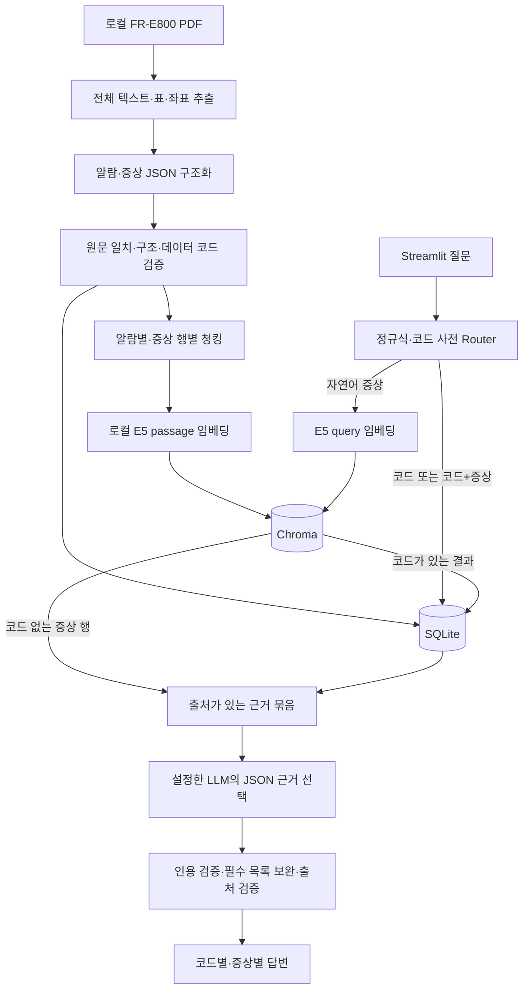

# Manufacturing Alarm RAG

제조설비 알람 코드와 자연어 증상을 **FR-E800 인버터의 실제 제조사 매뉴얼**에서 찾아, 점검 항목·대처 방법·페이지 근거를 제공하는 기본 하이브리드 RAG 서비스입니다. 포트폴리오의 초점은 기능 수보다 원문 추적, 정확한 코드 구분, 재현 가능한 평가에 있습니다.

이 프로젝트는 미쓰비시전기 **FR-E800 취급설명서(보수편)** 한국어 64페이지 문서를 대상으로 합니다. CR800 로봇 컨트롤러 매뉴얼용 파서가 아닙니다. 제조사 공식 서비스나 자동 설비 제어 도구가 아니며, 실제 작업에는 해당 설비의 안전 절차를 적용해야 합니다.

## 구현 범위

| 항목 | 현재 상태 |
|---|---|
| 전체 PDF 분석 | 64페이지, 표 132개, 텍스트·단어 좌표·원본 셀 추출 보존 |
| 알람 데이터 | 상세 레코드 75개, 고유 조작 패널 코드 88개 |
| 증상별 트러블슈팅 | 2.6.1–2.6.14의 14개 유형, 병합된 원인·대책 관계 보존 |
| 원문 검증 | 89개 레코드 통과, 격리 0개, 원문 데이터 코드 불일치 1개 기록 |
| 로컬 의미 검색 | multilingual-e5-small, 384차원, 청크 224개, 길이 초과 제외 0개 |
| 서비스 | 정확 코드 검색, 자연어 증상 검색, 근거 검증, Streamlit 세션 채팅 |
| LLM | OpenAI 호환 API 어댑터와 모의 응답 테스트 구현. 실제 API 호출·정답률은 사용자 요청으로 미측정 |
| 평가 | 원문 기반 40문항, API 없는 모드로 문항당 3회 실행 |

20개는 초기 파이프라인 검증 범위였으며, 최종 구축은 위의 전체 지원 범위로 확대했습니다. 세부 수치와 실행 조건은 [평가 보고서](evaluation/REPORT.md)를 확인하세요.

## 기술과 구조 선택

Python 3.11, PyMuPDF, SQLite, ChromaDB, Sentence Transformers, OpenAI Python SDK, Streamlit, pytest를 사용합니다. `requirements.lock.txt`는 검증 환경의 설치 버전을 기록하며 `requirements.txt`에는 직접 사용하는 라이브러리 범위를 표시합니다.

알람 코드는 철자 한 글자만 달라도 다른 원인·대책을 가리킬 수 있습니다. 따라서 코드 질문은 **SQLite 정확 검색**을 우선합니다. 반면 사용자가 코드 없이 증상을 설명하면 **Chroma 의미 검색**으로 관련 알람 또는 코드 없는 증상 행을 찾습니다. LLM은 선택된 원문 근거를 질문에 맞게 선택·정리하고, 프로그램이 필수 목록과 페이지 누락을 검사합니다.



서비스 요청 중에는 PDF를 열지 않습니다. PDF 읽기·검증·임베딩은 사전 구축 단계에서 수행합니다. 코드의 전체 문맥을 SQLite에 저장하므로 코드+증상 질문도 불필요한 벡터 검색 없이 원문과 대조할 수 있습니다.

## PDF 구조와 추출

| 범위 | PDF 실제 페이지 | 인쇄 페이지 | 처리 |
|---|---|---|---|
| 2.4 이상 표시 일람 | 16–17 | 15–16 | 패널 코드·분류·데이터 코드 구분 |
| 2.5 원인과 그 대책 | 18–35 | 17–34 | 코드별 내용·점검·대처·참고 자료·주석 |
| 2.6 증상별 확인 | 35–42 | 34–41 | 확인 부위·원인·대책 및 명시된 병합 관계 |

PyMuPDF의 기본 표 문자열만 사용하면 일부 좁은 행의 명칭과 데이터 코드가 섞였습니다. 한글 글꼴의 과도한 높이를 보정하고 셀 내부 단어 중심 좌표로 내용을 복원합니다. 일람표의 데이터 코드는 십진수와 16진수 토큰을 먼저 묶고, 묶음의 중심을 패널 코드 위치에 연결합니다. 원본 기본 추출 결과도 함께 보존하여 비교할 수 있습니다.

`HP1~HP2`, `E.16~E.20`, `E.MB1~7`, CPU 표의 `E.CPU/E.5/E.6/E.7`은 **원문이 명시한 코드 묶음**입니다. `E.SAF`의 서로 다른 사양별 설명은 별도 레코드로 유지합니다. 점검 목록과 대처 목록 사이에 원문이 제공하지 않은 1:1 연결은 만들지 않습니다. 2.6절은 실제 병합 셀만 이어받습니다.

검증은 PDF SHA-256, 셀 좌표에서 다시 읽은 원문, 필수 구조, 문자 깨짐, 데이터 코드의 십진수·16진수 일관성을 확인합니다. 추출 JSON이나 LLM의 자기평가를 정답으로 간주하지 않습니다. 다만 기계 검증이 모든 의미적 오독을 배제하거나 전문가 검토를 대체하지는 않습니다.

원문 일람표의 `E.OA` 데이터 코드는 `212 (HDD)`로, 십진수와 16진수가 일치하지 않습니다. 원문 값을 그대로 두고 `consistent=false`와 검토 이력을 기록하며 임의로 정정하지 않습니다. 데이터 코드와 패널 코드는 별개의 필드입니다.

## 저장소와 청킹

SQLite는 `documents → records → alarm_records → alarms` 관계로 원본·상세 항목·코드를 연결합니다. `alarm_items`는 종류·순번·문장·좌표 근거를 저장하며 `symptoms`는 원인·대책의 실제 행 구조를 보존합니다. 코드에 유일 제약을 두되 같은 코드의 여러 상세 레코드는 허용합니다. 검증한 전체 스냅샷을 임시 DB에서 만든 후 교체하므로 재실행 시 중복 INSERT나 이전 항목 잔존을 피합니다.

코드 정규화는 대소문자와 점 뒤 공백만 처리합니다. `EOC1`을 `E.OC1`로, `E.OC10`을 `E.OC1`로 유추하지 않습니다. 미등록 코드는 명시적으로 알리고 다른 알람으로 대체하지 않습니다.

Chroma 청크는 서로 다른 알람을 섞지 않고 **원문 불릿 전체**를 단위로 묶습니다. 증상 표는 제목과 확인 부위를 붙인 원인·대책 행 단위로 만듭니다. 실제 토크나이저로 길이를 검사하여 512토큰을 넘는 항목을 조용히 자르지 않고 별도 기록합니다. 긴 항목이 SQLite에서 누락되는 것은 아닙니다. 주석과 문맥의 알람 간 혼합을 피하기 위해 페이지 전체 문맥은 로컬 감사 자료로 두고, 해당 알람의 주석은 SQLite에서 보완합니다.

[E5 모델 카드](https://huggingface.co/intfloat/multilingual-e5-small)에 따라 한국어에도 문서는 `passage: `, 질문은 `query: `를 붙이고 정규화된 임베딩을 사용합니다. 구축 시 실제 모델 커밋 SHA를 manifest에 기록하고 서비스도 같은 revision을 로드합니다. 모델명·revision·차원·접두 규칙 또는 PDF 해시가 다르면 검색을 중단합니다. Chroma에는 chunk ID, 코드가 있는 경우의 error_code, section, 원본 파일, 실제·인쇄 페이지, content_type, 근거 ID를 저장합니다.

## 설치와 실행

프로젝트 루트에서 실행하세요. Windows PowerShell 예시입니다.

```powershell
python -m venv .venv
.\.venv\Scripts\python.exe -m pip install -r requirements.lock.txt
Copy-Item .env.example .env
```

다른 OS나 새 패키지 조합에서 설치할 경우 `requirements.txt`를 사용할 수 있지만, 평가 환경과 버전이 달라지므로 동일한 성능을 전제하면 안 됩니다. 최초 E5 모델 다운로드에는 네트워크와 디스크 공간이 필요하며 임베딩 연산은 로컬 CPU에서 실행됩니다.

원본 PDF를 아래 위치에 직접 준비합니다. 공개 저장소에는 포함하지 않습니다.

```text
data/raw/E800매뉴얼_보수편.pdf
```

파일이 없거나 지원하는 문서 구조가 아니면 명시적으로 실패합니다. OCR, 다른 제조사 매뉴얼, 가상 데이터로 대체하지 않습니다. 다른 파일 경로는 `.env`의 `PDF_PATH`에 지정할 수 있습니다.

사전 데이터 구축:

```powershell
.\.venv\Scripts\python.exe -m scripts.extract_pdf
.\.venv\Scripts\python.exe -m scripts.parse_alarms
.\.venv\Scripts\python.exe -m scripts.validate_data

# 최초 대표 20개 검증
.\.venv\Scripts\python.exe -m scripts.build_sqlite --limit 20 --output storage/initial-20.db
.\.venv\Scripts\python.exe -m scripts.build_chroma --limit 20

# 전체 범위 구축: 초기 검증 뒤 반드시 제한 없이 실행
.\.venv\Scripts\python.exe -m scripts.build_sqlite
.\.venv\Scripts\python.exe -m scripts.build_chroma
```

`data/processed/extraction_issues.json`, `validation.json`, `chunks.json`에서 추출·원문·청크 검증 결과를 확인할 수 있습니다. `python -m scripts.render_review 16 17 23 35`는 원문 페이지를 `tmp/pdfs`에 렌더링합니다. PDF나 JSON을 수정하면 검증을 다시 통과해야 적재할 수 있습니다. 새 인덱스는 구축이 끝난 뒤 manifest를 바꿔 사용하며, 이전 로컬 컬렉션은 자동 삭제하지 않습니다.

서비스 실행:

```powershell
.\.venv\Scripts\python.exe -m streamlit run app.py
```

브라우저에서 [로컬 서비스](http://localhost:8501)를 엽니다. 예시 질문은 `E.OC1의 원인과 대처 방법`, `E.THT가 가감속 시간 때문일 수 있어?`, `모터 시동이 걸리지 않아`입니다. 대화 기록은 현재 Streamlit 세션에만 남으며, 각 질문은 독립적으로 검색합니다. 대화 문맥에 의존하는 대명사 후속 질문은 지원하지 않습니다.

## 환경변수와 LLM 계약

| 변수 | 의미 |
|---|---|
| `PDF_PATH` | 로컬 원본 PDF |
| `SQLITE_PATH`, `CHROMA_PATH` | 검증 데이터 및 벡터 저장 위치 |
| `EMBEDDING_MODEL` | 기본 `intfloat/multilingual-e5-small` |
| `EMBEDDING_REVISION` | 선택적 모델 커밋 SHA. 비워 두면 구축 시 캐시 또는 Hub에서 해결하고 고정 |
| `HF_HOME` | 모델 캐시, 기본 `.cache/huggingface` |
| `LLM_BASE_URL` | OpenAI 또는 OpenAI 호환 제공자의 API 기본 주소 |
| `LLM_MODEL`, `LLM_API_KEY` | 사용자가 지정하는 모델과 키. 기본 모델 자동 선택 없음 |
| `LLM_TIMEOUT`, `LLM_MAX_TOKENS` | 요청 시간 및 출력 토큰 한도 |
| `LLM_TOKEN_PARAMETER` | 기본 `max_completion_tokens`. 제공자가 요구하면 `max_tokens`로 명시적 설정 |
| `TOP_K`, `MAX_DISTANCE` | 서비스 청크 수와 cosine distance 상한. 기본 3, 0.30 |

OpenAI 예시는 `LLM_BASE_URL=https://api.openai.com/v1`, OpenRouter 예시는 `https://openrouter.ai/api/v1`입니다. 모델명은 계정에서 실제 사용 가능한 값을 직접 설정하세요. JSON 객체 출력을 지원하는 Chat Completions 모델이 필요합니다. [공식 API 문서](https://developers.openai.com/api/reference/python/resources/chat/subresources/completions/methods/create)의 출력 한도 파라미터를 설정으로 구분하고, 임의 모델 전환이나 자동 재시도는 하지 않습니다.

LLM은 JSON으로 근거 ID와 **해당 항목 전체 인용**을 반환하는 추출형 생성 방식을 사용합니다. 새로운 기술적 주장을 자유롭게 추가하지 못하게 하여 검증 범위를 명확히 했습니다. 인용을 일부 잘라 조건이나 부정을 잃은 경우, 존재하지 않는 ID, 추가 응답 필드, 잘린 출력, API 실패는 명시적인 오류입니다. 필수 내용·체크 포인트·대처·주의사항은 원래 순서로 모두 보완하고 코드별로 표시합니다. 사용자의 가설을 실제 진단 결과로 단정하지 않습니다. 자유로운 의역·설명보다 원문 보존을 우선한 현재 버전의 의도적인 제약입니다.

LLM 모델과 키가 모두 설정되지 않은 앱은 **원문 검색 모드**임을 화면에 표시합니다. 이 모드는 API를 호출하지 않고 검색된 근거를 정리하며, 의미적 관련성이나 특정 원인 확인은 LLM 검증 결과로 주장하지 않습니다. 설정된 모델의 호출이 실패했을 때는 원문 모드나 다른 모델로 조용히 전환하지 않습니다. 이번 개발·평가는 사용자의 선택에 따라 실제 LLM 호출 없이 수행했습니다.

## 평가와 테스트

평가 질문은 코드 10개, 자연어 15개, 복합 10개, 미등록 코드·근거 부족 5개입니다. 공개 파일 `evaluation/cases.py`에는 직접 작성한 질문과 원문에서 확인한 정답 코드·절만 두고, 대량 정답 원문은 로컬에서 생성합니다.

```powershell
.\.venv\Scripts\python.exe -m evaluation.prepare_dataset
.\.venv\Scripts\python.exe -m evaluation.evaluate --mode evidence_only --repeats 3
.\.venv\Scripts\python.exe -m pytest -q
```

최종 검증 환경에서 테스트 **31개가 통과**했으며 `pip check`도 통과했습니다. 로컬 PDF·DB가 없는 공개 저장소 환경에서는 원문 통합 검사가 건너뛰어지므로, 데이터 구축 후 실행해야 같은 검증 범위를 확인할 수 있습니다.

핵심 지표는 세 개입니다.

1. **Hit@3**: 정답 코드가 명확한 자연어 질문만 평가합니다. 청크 순위를 코드 기준으로 중복 제거한 뒤 상위 3개를 계산합니다. 코드 없는 증상 질문 5개는 제외합니다.
2. **답변 정답률**: 필수 정답 원문, 모든 점검·대처, 코드 및 출처를 검사합니다. 증상 관련성·근거 부족 판단은 수동 검토 대상으로 남기며 미검토 항목이 있으면 전체 정답률을 확정하지 않습니다. 모의 LLM이나 원문 정리 출력으로 LLM 정답률을 대체하지 않습니다.
3. **응답 시간 p50/p95**: 질문 처리 시작부터 최종 검증·렌더링까지 측정합니다. 모델·인덱스를 한 번 예열하고 질문/답변 캐시는 사용하지 않습니다. 모델 최초 로딩, 브라우저 렌더링은 제외합니다. 실패 요청은 별도 집계하며 p95는 선형 보간합니다.

실제 결과는 [REPORT.md](evaluation/REPORT.md)에 있으며, 실행별 질문·답변·누락 항목은 `evaluation/results.json`, 실행별 요약은 `results.csv`에 저장합니다. 현재 Hit@3는 **90% (9/10)**입니다. LLM 답변 정답률과 LLM 포함 응답 시간은 **미측정**입니다. 보고서의 시간은 원문 검색 모드 40문항 × 3회의 측정값입니다. 부족 전압 자연어 질문의 검색 실패와 코드가 있으나 문서에 없는 다운로드 주소 질문의 한계도 숨기지 않고 기록합니다. 개발용 소규모 데이터셋이며 일반적인 실서비스 성능을 보장하는 수치는 아닙니다.

LLM 평가를 별도로 실행하려면 `.env`를 설정한 뒤 아래 명령을 사용합니다. 실제 API 비용이 발생하며 기본 반복 수는 1입니다.

```powershell
.\.venv\Scripts\python.exe -m evaluation.evaluate --mode llm --repeats 1
# 로컬 results.json 응답을 검토해 review.json 작성 후, API 재호출 없이 채점
.\.venv\Scripts\python.exe -m evaluation.evaluate --rescore --review evaluation/review.json
```

`review.json` 예시 형식은 `{"n11:0": {"approved": true, "answer_fingerprint": "results.json에 기록된 값"}}`입니다. 원문과 질문을 함께 검토해야 하며, 누락·잘못된 정보가 있으면 false로 표시합니다. 모호한 답변의 승인도 기계적 필수 항목 누락을 덮어쓰지는 못합니다.

## 파일 구조와 공개 범위

```text
app.py, config.py                 채팅 UI와 환경 설정
scripts/                          추출·구조화·검증·두 저장소 구축
rag/                              Router·정확/의미 검색·답변 생성·검증
evaluation/                       40문항 정의·로컬 정답 생성·평가·보고서
tests/                            코드 경계·멱등성·원문 변조·근거 누락·UI 검사
data/raw/                         사용자가 준비하는 PDF (비공개)
data/processed/                   전체 추출 JSON·검증 내역 (비공개)
storage/                          SQLite·Chroma (비공개)
```

PDF, 대량 추출 데이터, 정답 원문, 실제 답변 로그, DB/인덱스, 캐시, `.env`는 `.gitignore`로 제외합니다. 공개 저장소에는 코드·질문 사양·집계 보고서·환경변수 예시만 포함합니다. 원본 PDF의 재배포 권한을 가정하지 않습니다. 개발 규칙과 테스트→검토→Conventional Commit→push 절차는 [AGENTS.md](AGENTS.md)에 기록했습니다.

현재 한계는 특정 PDF 판본에 맞춘 표 파서, 작은 개발용 평가 세트, 의미 검색 실패 가능성, 자동 검증만으로 확정할 수 없는 증상 관련성, 미실행된 실제 LLM 연동·성능 평가입니다. 다른 매뉴얼이나 판본은 구조를 분석하고 파서·검증·평가를 다시 확인해야 합니다.
