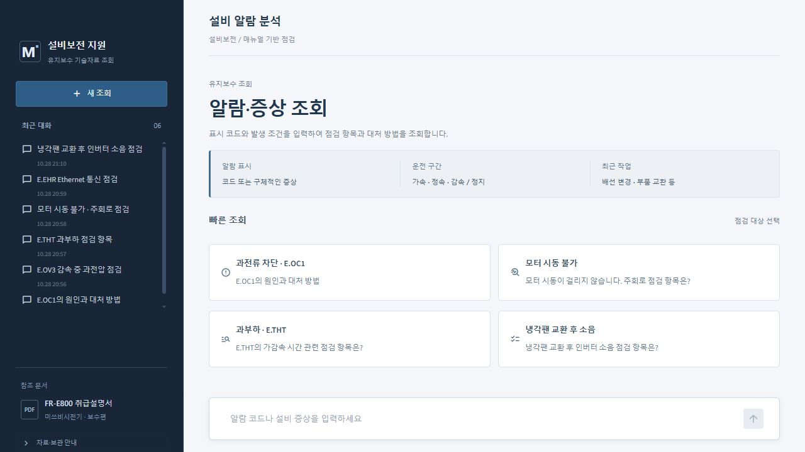
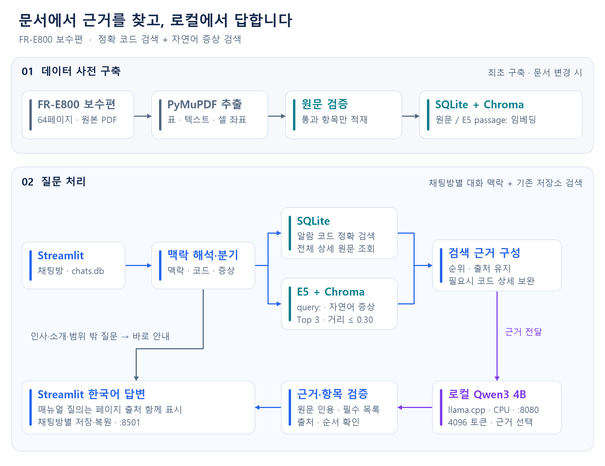
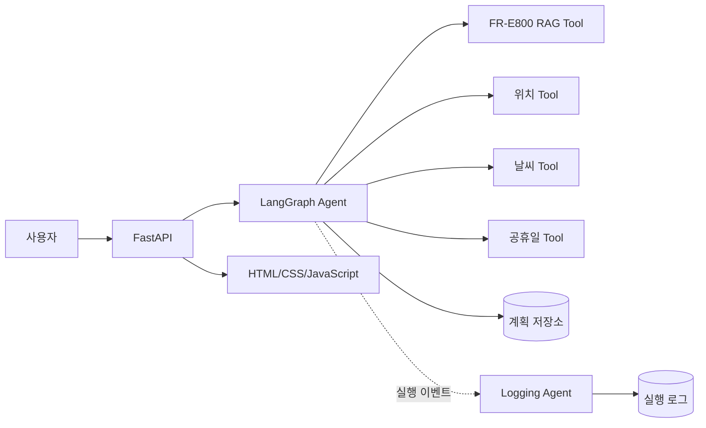
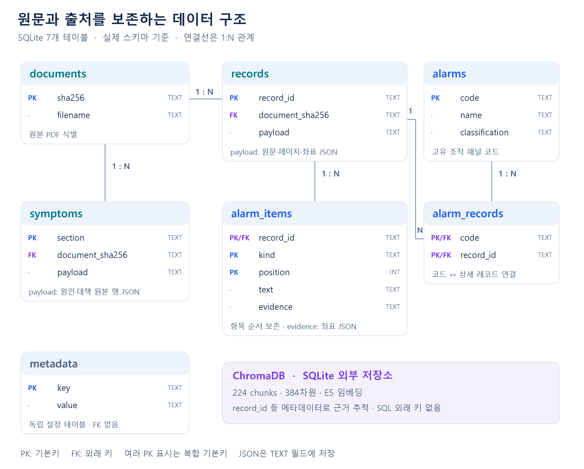

<h1 align="center">Manufacturing Alarm RAG</h1>
<p align="center">FR-E800 매뉴얼 RAG와 Agent 기반 정비 일정 플래너</p>

<p align="center">
  <a href="#프로젝트-개요">프로젝트 개요</a> ·
  <a href="#기술-스택">기술 스택</a> ·
  <a href="#주요-구현">주요 구현</a> ·
  <a href="#시스템-아키텍처">아키텍처</a> ·
  <a href="#erd">ERD</a> ·
  <a href="#실행-방법">실행 방법</a> ·
  <a href="#검증-결과">검증 결과</a> ·
  <a href="#3회차-제출-문서">3회차 문서</a>
</p>

## 프로젝트 개요

미쓰비시전기 FR-E800 인버터의 알람 코드와 운전 증상을 제조사 보수 매뉴얼에서 검색하는 로컬 RAG 질의응답 시스템이다. 알람의 원인·점검 항목·대처 방법을 조회하고, 답변에 원문 근거와 페이지 출처를 제공한다.

코드 한 글자의 차이로 점검 대상이 달라지는 설비 알람의 특성을 고려해 코드 일치 검색과 증상 의미 검색을 분리했다. 보수편 PDF 64페이지에서 고유 코드 88개, 알람 상세 레코드 75개, 증상 유형 14개를 구조화하고 224개 청크로 검색 인덱스를 구축했다.

3회차에서는 기존 RAG를 `search_fr_e800_manual` Tool로 감싸고 LangGraph 정비 플래너를 추가했다. 사용자가 날짜·지역·시간대·강수·공휴일 조건을 입력하면 외부 API 결과와 제약을 비교하고, 첫 후보가 맞지 않으면 기존 Tool 결과를 재사용해 다음 날짜를 판단한다. 진단 근거와 일정 정보는 분리하며 매뉴얼에 없는 작업 시간이나 조치를 만들지 않는다.



## 기술 스택

<table>
  <tr><th align="center">구분</th><th align="center">기술 스택</th></tr>
  <tr><td align="center">Frontend</td><td align="center">   </td></tr>
  <tr><td align="center">Backend</td><td align="center">  </td></tr>
  <tr><td align="center">Document Processing</td><td align="center"></td></tr>
  <tr><td align="center">RAG &amp; Storage</td><td align="center"> </td></tr>
  <tr><td align="center">Embedding</td><td align="center"> </td></tr>
  <tr><td align="center">LLM</td><td align="center">  </td></tr>
  <tr><td align="center">Test &amp; Tools</td><td align="center"> </td></tr>
</table>

## 주요 구현

| 구현 항목 | 내용 |
|---|---|
| PDF 표 구조 복원 | 셀 좌표와 단어 위치를 기준으로 원인·점검·대처 항목을 추출하고, PDF 실제 페이지와 문서 내부 페이지를 구분해 저장했다. |
| 코드·증상 검색 분리 | 알람 코드는 SQLite에서 일치 검색한다. 증상은 E5 의미 검색과 본문·제목 BM25 순위를 RRF로 결합하고, 운전 구간과 설비 대상을 대조한다. 동일 알람의 원문을 확장하며, 구분이 어려운 코드는 재확인한다. |
| 답변 검증 | Qwen3는 근거 ID를 선택하고 프로그램이 전체 원문을 복원한다. 필수 점검·대처, 절차 순서, 매뉴얼명과 페이지를 검증해 조건 누락과 출처 불일치를 차단했다. |
| 대화 상태 관리 | 채팅방별 알람·증상 맥락을 기준으로 후속 질의를 보완하고, 대화 기록을 별도 SQLite DB에 저장했다. |
| Agent 실행 흐름 | 분석→계획→실행→판단→재계획→응답을 LangGraph 노드로 분리했다. 인사에는 Tool을 부르지 않고 일정 제약이 있을 때만 필요한 Tool을 계획한다. |
| 외부 일정 Tool | Open-Meteo 지오코딩, MET Norway 날씨, Nager.Date 공휴일을 공통 `ok/data`·`ok/error` 계약으로 래핑했다. |
| 실행 이벤트·로그 | 단계, Tool 요청·결과·소요 시간, 판단, 재계획을 이벤트로 발행하고 LLM을 쓰지 않는 로깅 Agent가 불변 로그로 저장한다. |
| 계획 관리 | 날짜·시간 계획 CRUD와 같은 날짜의 시간 겹침 경고를 제공한다. 겹쳐도 저장은 유지한다. |

## 시스템 아키텍처



문서 구축과 질의 처리를 분리했다. 검증된 원문을 SQLite에 저장하고, 같은 문서의 E5 임베딩을 ChromaDB에 적재했다. 답변 생성에는 llama.cpp 서버와 Qwen3 4B Q4_K_M을 사용했다.



## ERD



알람 코드와 상세 레코드를 다대다로 연결하고, 점검·대처 항목의 순서와 좌표 근거를 보존했다. 대화 기록은 매뉴얼 DB와 분리해 관리했다.

## 실행 방법

### 1. 환경 준비

```powershell
python -m venv .venv
.\.venv\Scripts\Activate.ps1
python -m pip install -r requirements.txt
Copy-Item .env.example .env
```

원본 FR-E800 보수편 PDF는 Git에 넣지 않고 `.env`의 `PDF_PATH`로 지정한다. 데이터 구축은 [설정 문서](docs/SETUP.md)를 따른다. 임베딩은 `intfloat/multilingual-e5-small`의 `query:`/`passage:` 규칙과 같은 모델을 사용한다. 지정 모델·원본·인덱스가 없으면 다른 모델이나 가상 데이터로 대체하지 않는다.

### 2. 3회차 FastAPI·웹 화면

```powershell
python -m uvicorn api:app --host 127.0.0.1 --port 8000
```

- 웹 화면: `http://127.0.0.1:8000`
- OpenAPI: `http://127.0.0.1:8000/docs`
- 상태 확인: `http://127.0.0.1:8000/api/v1/health`

예시 요청:

```text
E.OC1 점검 근거와 다음 주 수원시, 경기도에서 비 없는 평일 오전 공휴일 제외 정비 계획을 세워줘
```

### 3. 기존 2회차 Streamlit 화면

```powershell
streamlit run app.py
```

### 4. 테스트

```powershell
python -X utf8 -m pytest -q
```

## 외부 API 출처와 조건

| 출처 | 용도 | 설정·조건 요약 |
|---|---|---|
| [Open-Meteo Geocoding](https://open-meteo.com/en/docs/geocoding-api) | 지역 후보와 좌표 | 교육용 비상업 무료 API, 키 불필요, GeoNames/Open-Meteo 출처 표시 |
| [MET Norway Locationforecast](https://api.met.no/weatherapi/locationforecast/2.0/documentation) | 강수·기온·풍속 예보 | 식별 User-Agent 필수, 좌표 소수 4자리, 캐시·반복 호출 간격·20 req/s 미만 준수, CC BY 4.0 표시 |
| [Nager.Date v4](https://github.com/nager/Nager.Date/blob/main/doc/examples/rest-api.md) | 국가별 공휴일 | 호스팅 REST API 키 불필요, v4 사용, 정책 변화 확인 |

MET Norway 약관은 AI가 대신 수락할 수 없다. 운영 책임자는 배포 전에 [최신 이용 약관](https://api.met.no/doc/TermsOfService)을 직접 검토하고 User-Agent의 연락 경로, 캐시, 트래픽, 개인정보 처리 방식을 확정해야 한다.

## 검증 결과

### 3회차 Agent·API

- 외부 Tool 실제 Agent 실행: 3개 성공, 2.923초, 재계획 1회, 이벤트 23건, 로깅 전달 실패 0건
- 실제 결과: 2026-11-23 강수 예보로 제외, 2026-11-24 오전 선택
- 자동 테스트: 155 passed, 16 skipped, 0 failed (6.61초). 건너뛴 항목은 로컬 원본·DB·Vector·모델 의존 테스트다.
- 브라우저 검증: 319px 모바일과 1024×768 데스크톱, 대화·계획·로그 API 연동, 콘솔 오류 0건

로컬 매뉴얼 DB·Vector DB와 지정 Qwen 모델 파일이 없는 현재 작업 공간에서는 실제 RAG·LLM 통합을 실행하지 않았다. `NO_INDEX`와 모델 부재를 숨기거나 다른 모델로 대체하지 않는다.

### 2회차 RAG

| 항목 | 개선 전 | 개선 후 |
|---|---|---|
| 기존 자연어 10문항 Hit@1 | 7/10 | 9/10 |
| 기존 자연어 10문항 Hit@3 | 9/10 | 10/10 |
| 추가 자연어 15문항 Hit@1 · Hit@3 | 14/15 · 14/15 | 15/15 · 15/15 |
| 기존 40문항 응답 검사 | 전체 실제 추론 미실행 | 39/40 |
| 추가 25문항 응답 검사 | 미실행 | 25/25 |
| 다회차·채팅방 분리 | — | 12/12 |
| 응답 시간 · 예열 상태 9회 | — | 중앙값 4.61초 · p95 17.28초 |
| 자동 테스트 | 136/136 | 155/155 · 실패 0 · 건너뜀 0 |

검색 지표는 정답 코드가 있는 자연어 질문에서 코드 중복을 제거한 뒤 계산했다. 기존 40문항 중 35문항은 실제 Qwen3 CPU 추론을 사용했고, 5문항은 코드 확인 요청·미등록 안내로 처리했다. 응답 검사는 필수 원문·출처 검증과 Codex의 질문 적합성 검토를 결합했다. 설비 전문가의 독립 검수와 실제 고장 진단 정확도 평가는 포함하지 않는다.

부족 전압 질문 1건은 UV와 E.UVT를 구분할 정보가 없어 표시 코드를 요청했다. 기존 정답을 바꾸지 않아 응답 검사에서는 실패로 집계했다. 추가 문항도 개발 중 작성·확인한 세트이며, 독립된 현장 평가와 긴 대화·동시 접속 평가는 남아 있다. 자동 테스트에는 모의 LLM·HTTP 검사가 포함된다. 시간 측정은 대표 질문 3개를 각 3회 반복한 결과로, 모델 최초 로딩과 브라우저 렌더링을 제외했다.

[검색·답변 개선 결과](evaluation/IMPROVEMENT_REPORT.md) · [기존 평가 범위](evaluation/EVALUATION_AUDIT.md)

## 3회차 제출 문서

- [요구사항 정의서](docs/round3/REQUIREMENTS.md)
- [Agent 설계 문서](docs/round3/AGENT_DESIGN.md)
- [Tool 정의서](docs/round3/TOOL_SPEC.md)
- [API 명세서](docs/round3/API_SPEC.md)
- [검증 결과](docs/round3/VALIDATION.md)
- [셀프 체크](docs/round3/SELF_CHECK.md)
- [전체 실행 로그 샘플](docs/round3/samples/execution-log.json)
