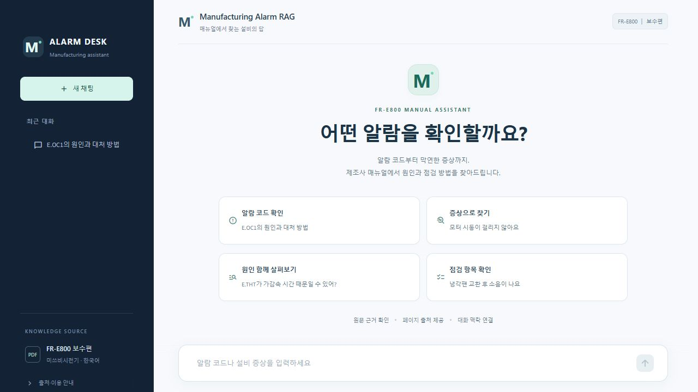
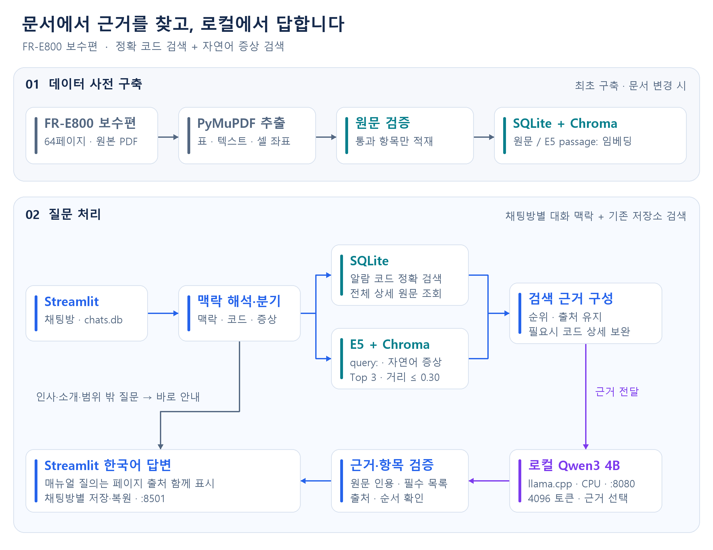
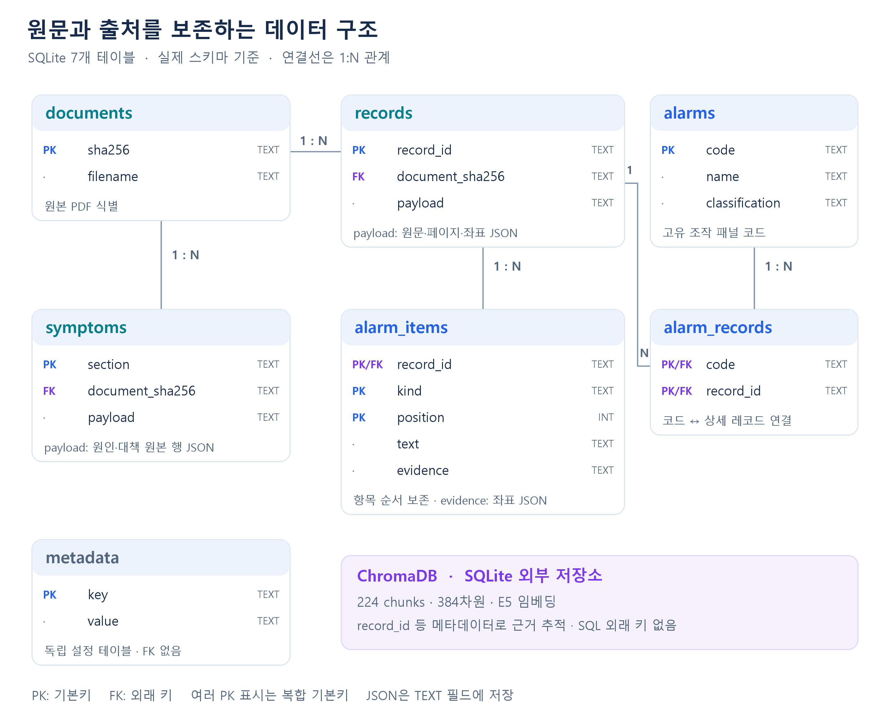

<h1 align="center">⚙️ Manufacturing Alarm RAG</h1>
<p align="center"><b>알람 코드와 증상으로 찾는 FR-E800 매뉴얼 도우미</b><br>제조사 원문 검색 · 페이지 근거 검증 · 로컬 Qwen3 답변</p>

<p align="center">
  <a href="#프로젝트-소개">소개</a> ·
  <a href="#시스템-아키텍처">아키텍처</a> ·
  <a href="#erd">ERD</a> ·
  <a href="#기술-스택">기술 스택</a> ·
  <a href="#실행-방법">실행 방법</a> ·
  <a href="#검증-결과">검증 결과</a>
</p>

## 프로젝트 소개

미쓰비시전기 **FR-E800 취급설명서(보수편)**에서 알람의 원인·점검 항목·대처 방법을 찾아주는 RAG 서비스입니다. 검색한 원문을 바탕으로 한국어 답변과 **매뉴얼명·PDF 페이지·문서 내부 페이지**를 제공합니다.



| 핵심 기능 | 동작 |
|---|---|
| 알람 코드 검색 | `E.OC1의 원인과 대처 방법` → SQLite 정확 검색 |
| 자연어 증상 검색 | `모터 시동이 걸리지 않아` → E5 + Chroma 의미 검색 |
| 근거 기반 답변 | 로컬 Qwen3가 원문 근거를 선택하고, 프로그램이 필수 항목·순서·출처를 검증 |
| 채팅방·대화 맥락 | 왼쪽에서 새 채팅·이전 방 선택, 같은 방의 알람·증상에 대한 후속 질문 지원 |

**64페이지 · 고유 알람 코드 88개 · 상세 레코드 75개 · 증상 유형 14개 · 검색 청크 224개**

## 시스템 아키텍처



PDF 추출·검증·임베딩은 사전에 수행합니다. 질문 처리 시에는 기존 저장소를 검색하며, 로컬 LLM이 선택한 근거를 원문과 대조한 뒤 표시합니다. 인사·서비스 소개는 검색과 LLM 호출 없이 안내합니다. [그림 원본](docs/images/architecture.svg)

## ERD



위 그림은 매뉴얼 DB의 구조입니다. SQLite는 알람 코드·상세 원문·항목 순서·출처를 보존합니다. `payload`와 `evidence`는 JSON을 담은 TEXT 필드이며, Chroma는 별도 벡터 저장소입니다. 채팅방·메시지는 별도 `storage/chats.db`에 저장합니다. [스키마 코드](scripts/build_sqlite.py) · [그림 원본](docs/images/erd.svg)

## 기술 스택

| 영역 | 기술 |
|---|---|
| 화면 | Streamlit |
| 문서 처리 | PyMuPDF · 원문/셀 좌표 검증 |
| 검색 저장소 | SQLite · ChromaDB |
| 임베딩 | multilingual-e5-small · 384차원 · `query:` / `passage:` |
| 로컬 LLM | Qwen3 4B Q4_K_M · llama.cpp · requests |
| 개발·검증 | Python 3.11 · pytest · 40문항 평가 세트 |

## 실행 방법

Windows PowerShell 기준입니다. 처음 실행한다면 **[설치·PDF/모델 준비·데이터 구축](docs/SETUP.md)**을 먼저 진행하세요. 구축된 DB와 인덱스가 있으면 재사용합니다.

```powershell
# 1. 로컬 LLM 서버 시작 (127.0.0.1:8080, CPU)
powershell -NoProfile -ExecutionPolicy Bypass -File .\scripts\start_llm.ps1

# 2. Streamlit 실행
.\.venv\Scripts\python.exe -m streamlit run app.py --server.address 127.0.0.1 --server.port 8501 --server.headless true
```

**[채팅 열기](http://127.0.0.1:8501)** · [모델 서버 상태](http://127.0.0.1:8080/health)

기본 로컬 구성은 외부 LLM API나 API 키를 사용하지 않습니다. 서버가 꺼져 있으면 화면에 시작 방법을 안내합니다.

## 검증 결과

| 지표 | 실제 측정 결과 |
|---|---|
| 검색 Hit@3 | **90% (9/10)** — 정답 코드가 있는 자연어 질문 기준 |
| 실제 Qwen3 추론 | 단독 한국어 생성 및 RAG 연결 확인 |
| 실제 후속 질문 응답 시간 | **23.08초** — E.THT 맥락을 이어받은 1회 실측 |
| 전체 40문항 LLM 답변 정답률 | **미측정** |

검색 평가는 40문항 중 코드 정답이 있는 자연어 질문 10개를 대상으로 하며, 코드 없는 증상 질문 5개는 Hit@3에서 제외합니다. 시간은 CPU에서 모델을 미리 로드한 후속 질문 1회 실측입니다. 입력 길이·prompt/KV 캐시·동시 작업에 따라 달라지며, 최초 로딩과 브라우저 렌더링은 제외했습니다.

[검색 회귀 보고서](evaluation/local_llm/chat_regression/REPORT.md) · [실제 LLM·채팅 검증](evaluation/CHAT_CONTEXT_REPORT.md) · [테스트 실행 방법](docs/SETUP.md#테스트와-평가)

## 데이터 및 지원 범위

- **FR-E800 보수편만 적재**합니다. 답변에 등장하는 기능편은 보수편에 기재된 참고 문헌이며, 기능편 원문을 검색하는 것은 아닙니다.
- 원본 PDF·추출 데이터·DB·인덱스·모델·`.env`는 저장소에 포함하지 않습니다. 모델 가중치는 프로젝트 외부에서 관리합니다.
- **새 채팅**은 빈 대화 화면으로 이동하며, 첫 질문을 보내면 목록에 저장됩니다. 왼쪽에서 이전 방을 눌러 이어갈 수 있고, 새로고침·서버 재시작 후에도 기록이 복원됩니다.
- 같은 방에서 `E.OC1 원인` → `그럼 대처는?`처럼 질문할 수 있습니다. 새 알람 코드·새 증상은 우선하고, 대상이 모호하면 확인을 요청합니다. 이전 대화 자체를 매뉴얼 근거로 사용하지 않습니다.
- 문서에 없는 내용은 확인 불가로 안내합니다. 실제 점검·조작에는 해당 설비의 안전 절차와 제조사 매뉴얼을 적용하세요.
