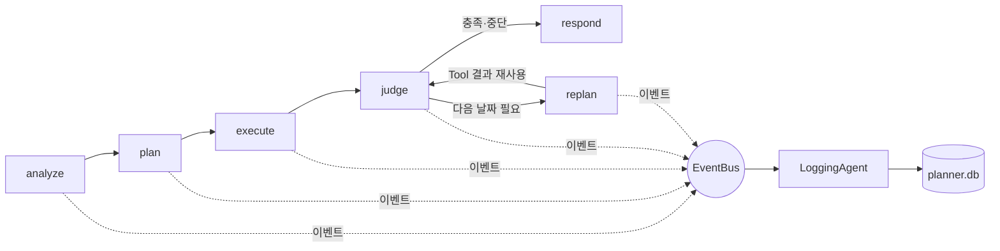

# Agent 설계 문서

## 1. 책임 분리

메인 Agent는 요청 분석, Tool 계획, 호출, 제약 판단, 재계획, 응답을 수행한다. 로깅 Agent는 메인 Agent가 발행한 이벤트를 원문 그대로 저장한다. 이벤트 발행자는 구독자를 알지 못하며, 로깅 저장이 실패해도 메인 흐름은 계속된다.

## 2. LangGraph 상태

| 필드 | 의미 |
|---|---|
| `session_id` | 실행 1건의 식별자. 실행 로그의 외래키다. |
| `conversation_id` | 후속 요청 메모리를 공유하는 대화 식별자다. |
| `analysis` | 의도, 명시 조건, 부족 조건, 판단 이유다. |
| `tool_plan` | Tool 이름, 고정 인자, 앞선 결과 의존성을 순서대로 보관한다. |
| `tool_results` | 공통 Tool 응답을 Tool 이름별로 보관한다. |
| `candidate_dates`, `candidate_index` | 재계획 중 현재 평가할 날짜를 나타낸다. |
| `replan_count` | 재계획 횟수다. 기본 상한 3회를 넘지 않는다. |
| `exclusion_reasons` | 날짜별 제외 이유다. |
| `response` | API에 반환할 최종 구조다. |

## 3. 단계별 입출력

### analyze

- 입력: 사용자 원문, 현재 KST 날짜, 이전 세션 조건
- 출력: `maintenance_plan`, `manual_search`, `greeting`, `usage`, `out_of_scope` 중 하나와 명시 조건
- 규칙: 없는 날짜·지역·작업 시간은 채우지 않는다. `같은 조건` 같은 후속 표현일 때만 이전 조건을 병합한다.

### plan

- FR-E800 근거가 필요한 요청: `search_fr_e800_manual`
- 강수 조건과 지역이 있는 요청: `search_maintenance_location` → `get_maintenance_weather`
- 공휴일 제외가 명시된 요청: `get_public_holidays`
- 인사·사용법: Tool 계획 없음

규칙으로 확정할 수 있는 요청은 LLM을 호출하지 않는다. 이번 작업 공간에는 지정 Qwen 모델과 llama.cpp 실행 파일이 없어 LLM Tool 선택 검증은 실행하지 않았다. 다른 모델로 바꾸지 않았으며, 모델 기반 경로를 동작했다고 보고하지 않는다.

### execute

- 계획 순서대로 Tool을 호출한다.
- 앞선 위치 결과의 위·경도와 시간대를 날씨 Tool 입력으로 전달한다.
- 동명이인 후보가 하나로 좁혀지지 않으면 날씨를 호출하지 않고 `AMBIGUOUS_LOCATION`을 반환한다.
- Tool 요청, 결과, 소요 시간을 이벤트로 발행한다. 응답 원문 전체는 로그에 복제하지 않는다.

### judge

- 날짜 범위에서 평일과 공휴일 제외 조건을 먼저 적용한다.
- 선호 시간대에 강수량이 모두 확인되고 0이며 비·눈 코드가 없을 때만 `비 없음`으로 판단한다.
- 날씨나 공휴일 Tool이 실패하면 확인하지 못한 값을 충족으로 바꾸지 않고 `constraint_unavailable`로 중단한다.
- FR-E800 매뉴얼의 점검 항목을 날씨 조건과 연결하지 않는다.

### replan

- 현재 날짜가 조건에 맞지 않으면 다음 날짜 인덱스로 이동한다.
- 위치·날씨·공휴일 Tool 결과를 다시 호출하지 않는다.
- 상한에 도달하면 제외 이유와 함께 `replan_limit`을 반환한다.

### respond

- 매뉴얼 Tool 응답은 프로그램 검증을 통과한 전체 근거와 페이지를 그대로 포함한다.
- 일정 출처와 매뉴얼 출처를 구분한다.
- 작업 시간이 없으면 날짜만 제안하고 시작·종료 시각은 만들지 않는다.

## 4. 대화 메모리

`planner_memory`는 대화 식별자별로 날짜, 지역, 시간대, 사용자 제약의 요약만 저장한다. 외부 API 원본 응답과 생성된 진단은 메모리로 사용하지 않는다. 사용자가 새 조건을 명시하면 해당 필드만 바꾸며 `비 조건 빼고`, `공휴일 포함` 같은 해제 표현도 처리한다.

## 5. 이벤트와 로깅

| 이벤트 | 주요 필드 |
|---|---|
| `stage.started`, `stage.completed` | 단계, 상태 요약 |
| `agent.decision` | 의도·Tool 목록·제약 판정, 이유, 판단 출처 |
| `tool.requested` | Tool 이름과 인자 |
| `tool.completed` | 성공 여부, 실패 코드, 소요 시간 |
| `agent.replanned` | 재계획 횟수, 다음 후보, 결과 재사용 여부 |

로깅 Agent는 LLM을 호출하지 않는다. SQLite 외래키와 `(session_id, sequence)` 유일 제약으로 순서를 보존한다. API는 목록·상세·삭제만 제공하고 수정 경로는 없다.

## 6. 저장 구조

- `maintenance_plans`: 사용자가 확정한 정비 계획
- `execution_sessions`: 요청 원문, 상태, 시작·종료 시각
- `execution_events`: 순서가 있는 불변 실행 이벤트
- `planner_memory`: 후속 요청용 조건 요약

검증된 매뉴얼 DB와 플래너 DB는 물리적으로 분리한다. `PLANNER_DB_PATH`, `SQLITE_PATH`, `CHAT_DB_PATH`가 같으면 서버 시작을 거부한다.
